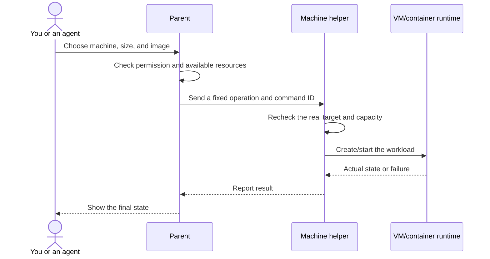

# MetaService, explained like a system you already use

MetaService lets one small control panel manage real computers: create VMs, discover existing services, run agent sandboxes, and see what each machine is doing.

It is **not a cloud provider by itself**. It is the control system for machines you already own.

## Start with four ideas

| Idea | Human explanation | Technical meaning |
|---|---|---|
| **Machine** | A real computer in the office or elsewhere | Mac Mini, Mac Studio, DGX Spark, RTX PC |
| **Parent** | The coordinator that knows what every machine should do | Inventory, API, placement, commands, audit |
| **Helper** | The local technician on each machine | Executes operations and reports real results |
| **Workload** | Something running on a machine | VM, container, sandbox, or existing service |

The parent does not need to be the fastest computer. It needs to know what is happening and make safe decisions.

## What happens when you click Create VM

Each step has a different job:

1. **You choose what you want.**
2. **The parent decides whether it is allowed and where it fits.**
3. **The helper checks the real machine again.** A machine that looked free a second ago may not be free now.
4. **The runtime performs the action.**
5. **The result comes back.** HTTP 202 only means the request was accepted, not that the VM is already running.

## Why helpers exist

Imagine the parent asking a machine to stop a container. It should not send a shell command such as `rm -rf ...` and hope nothing goes wrong.

The helper exposes a small set of safe operations:

- List workloads
- Create a workload with a known shape
- Start, stop, restart, or delete a known target
- Report real CPU, memory, disk, and GPU readings
- Return a bounded, useful error

The caller chooses an operation. The helper chooses the exact safe command arguments.

## Managed versus external services

Not everything on a machine was created by MetaService.

| Type | Example | What MetaService may do |
|---|---|---|
| **Managed workload** | A VM created through the Compute page | Create, start, stop, back up, delete according to policy |
| **External service** | A Docker container someone started earlier | Discover it and show its state; allow only explicit lifecycle controls |
| **Sandbox** | A short-lived environment for an agent | Create with an API key, limit lifetime/resources, pause/resume/kill, record usage |

External services stay separate from managed placement budgets. Their existence does not mean MetaService owns their data or may delete them.

## VM, container, sandbox—without the jargon

### VM

A small computer running inside a real computer. It has its own kernel and operating system.

### Container

An isolated group of processes that usually shares the host’s kernel. It starts faster and uses less memory, but the host kernel is shared.

### Sandbox

The rules around running code: what files it can access, what network it can use, how much CPU/RAM/GPU/time it gets, which secrets it receives, and when it must stop.

A sandbox can be implemented using a container, VM, microVM, or restricted process. **A container by itself is not automatically a safe sandbox for untrusted code.**

## What you see in the product

| Page | What it answers |
|---|---|
| **Live** | How is this machine doing right now? |
| **Compute** | What is running here, and who owns it? |
| **Storage** | What is using disk space? |
| **Sandboxes** | Which agent environments exist, which keys can create them, and how much did they use? |
| **Environment** | What is this machine, and how is it configured? |
| **Activity** | What commands succeeded or failed? |

## Three resource numbers that people often mix up

1. **Real machine memory:** what the host is actually using, including external services and the OS.
2. **Managed allocation:** what MetaService promised to its managed workloads.
3. **Placement capacity:** what MetaService may still allocate after reserves and existing promises.

A machine can show little managed allocation and still have substantial real usage from external services. That is not a bug.

## Safety rules built into the model

- Discovery is read-only.
- External deletion is not offered.
- Lifecycle commands use command IDs so retries do not repeat side effects.
- Targets are resolved again before mutation.
- Failures return actual bounded errors instead of false success.
- No AI provider key is placed inside an ordinary workload.
- External-service state never changes managed resource accounting.

## Current versus future

| Area | Today | Possible later, with separate approval |
|---|---|---|
| On-prem Compute | Parent, helpers, managed VMs, external discovery | More machine types and provider adapters |
| Agent sandboxes | Keys, expiration, pause/resume/kill, usage | Stronger isolation proofs and fork/cloning |
| AWS | No deployed adapter | ECS Anywhere or EC2 burst experiments |
| Liquid Compute | No deployed integration | Verification, delivery evidence, market/settlement integration |
| Billing | Usage records | Pricing, statements, credits, and payment policy |

Do not read the future column as shipped functionality.

## Go deeper

- [Office network and cabling](office-network.md): why a cable can be connected but the public gateway still cannot respond.
- [Hybrid AWS and Liquid Compute](hybrid-aws-liquid-compute.md): how on-prem execution, AWS services, and a compute market could fit together.
- [Integration prompt](PROMPT-liquid-compute.md): a copy-ready prompt for producing a careful PRD.

For current production state, use the latest private MetaService handover. These public documents explain the model without exposing exact access addresses or credentials.
