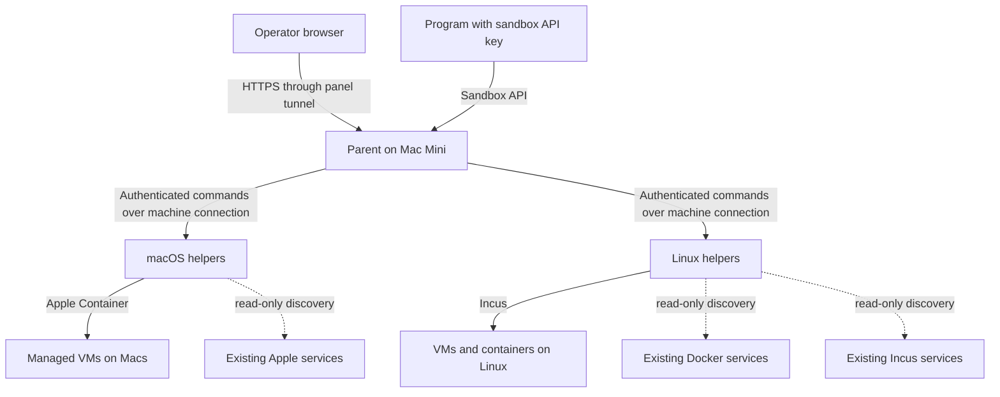

# MetaService architecture

This section describes the current architecture and its hybrid-compute direction. It is safe to publish: exact host addresses, MAC addresses, wall-side credentials, and tokens remain in the private operations knowledge base.

## Documents

- [Office network and cabling](office-network.md)
- [Hybrid AWS and Liquid Compute](hybrid-aws-liquid-compute.md)
- [Liquid Compute integration prompt](PROMPT-liquid-compute.md)

## Current shape

MetaService is a self-hosted compute control plane. One **parent** manages multiple physical **machines**. A native **helper** on each machine executes local operations through a versioned contract.

## Responsibilities

### Parent

- Operator panel and API
- Machine inventory, enrollment, health, and resource budgets
- Placement and lifecycle commands
- Persistent command IDs, polling, retry recovery, and audit records
- Sandbox keys, teams, expiration, and usage records
- Machine storage maps and helper updates

The parent coordinates work; it does not replace the runtime on each machine.

### Helpers

- Report real hardware, capabilities, and live readings
- Create and manage managed workloads
- Discover existing services without adopting or changing them
- Revalidate targets immediately before lifecycle actions
- Return actual, bounded errors rather than misleading success

macOS uses Swift and Apple Container. Linux uses Rust and Incus. External Docker services are discovered separately from managed workloads.

## Product surfaces

- **Live:** real machine CPU, memory, disk, network, and GPU readings
- **Compute:** managed VMs and external services in one Building, with origin shown separately
- **Storage:** disk maps and reclaimable-space classification
- **Sandboxes:** Live, API keys, and Usage tabs
- **Security:** intended to centralize machine security evidence; consult the current handover for which data paths are implemented

## State and ownership boundaries

- Managed workloads affect MetaService placement budgets.
- External services do not enter managed placement accounting.
- External discovery is read-only.
- Explicit external start/stop/restart uses fresh target resolution and audited commands.
- External deletion is not offered.
- Real host memory, managed allocation, and placement capacity are different measurements and must not be mixed.
- An idle workload can still hold RAM, disk, or reserved GPU memory.

## Current hybrid direction

MetaService remains the on-prem compute and ownership layer. AWS can add cloud/container orchestration and storage; Liquid Compute is a potential market, verification, pricing, settlement, and delivery layer—not a workload runtime.

See [Hybrid AWS and Liquid Compute](hybrid-aws-liquid-compute.md) for the proposed boundaries and phased plan. No AWS or Liquid Compute integration is implied by this document.

## Authoritative current-state references

The repository contains design documents and history. For the current production state, use the latest private MetaService handover and the operational runbooks. The public architecture documents here deliberately omit sensitive network details.
