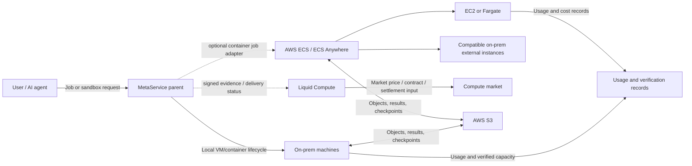

# Hybrid AWS and Liquid Compute

Status: **architecture proposal only**. No integration is built or deployed. Do not turn this proposal into infrastructure changes without a separate approved PRD.

## 1. First-principles separation

The three systems solve different problems:

| System | Role |
|---|---|
| **MetaService** | Own on-prem machines, helpers, managed VMs, external-service inventory, sandbox API, lifecycle, usage, and audit |
| **AWS** | Cloud compute, container orchestration, queues, object storage, identity, logging, and optional hybrid container management |
| **Liquid Compute** | Compute market/exchange: reference pricing, verification, matching, clearing, settlement, financing, and physical delivery |

Liquid Compute is **not an ECS-like runtime**. Do not design it as a machine scheduler unless its official API documentation explicitly offers that capability.

## 2. Recommended high-level model

Solid lines are execution. Dotted lines are proposed integration boundaries.

## 3. AWS choices

### ECS Anywhere — recommended first AWS hybrid experiment

Use it when the goal is **one ECS control plane for compatible containers in AWS and on-prem**.

AWS states that ECS Anywhere:

- Runs container applications on on-prem VMs or bare metal
- Uses the ECS agent, Systems Manager Agent, Docker, and an external-instance registration
- Requires stable internet connectivity to the AWS control plane
- Supports compatible Linux/Windows Server environments; it is not a macOS helper replacement
- Can use supported GPU configurations, but our OS, CPU architecture, NVIDIA drivers, and device access still need verification
- Allows external, EC2, and Fargate capacity in one ECS cluster
- Keeps existing tasks running during a control-plane disconnect, but mutation/scaling stops; task credentials can expire

Current AWS FAQ price: **$0.01025 per managed external instance-hour**. Recheck pricing before budgeting.

### AWS EC2 adapter — use for cloud burst VMs

Use when MetaService needs to create/delete actual cloud VMs rather than submit containers to ECS.

The adapter would map a placement request to EC2 instance type, image, storage, network, and lifetime policy. It needs strict quota and cost ceilings. This is a separate provider adapter, not ECS Anywhere.

### AWS Outposts — not the first experiment

Outposts is for deploying AWS-managed infrastructure at a site. It does not simply reuse our existing Macs and PCs. It has a much larger procurement/operational commitment.

## 4. Recommended execution ownership

| Workload | Owner |
|---|---|
| Apple Container managed VM | MetaService macOS helper |
| Incus managed VM/container | MetaService Linux helper |
| Existing Docker service | Its existing owner; MetaService discovers it as external |
| ECS Anywhere task | AWS ECS, through a future explicit adapter |
| EC2 cloud VM | AWS provider adapter |
| Liquid Compute contract/delivery | Liquid Compute integration layer |

**Never let two controllers mutate one workload.** If an ECS task appears as a Docker container, MetaService must identify it as AWS-managed and suppress ordinary external start/stop/restart unless an explicit ownership handoff exists.

## 5. Data and networking

Start with outbound TLS and object storage rather than a complex site-to-site network:

- S3 for job inputs, results, checkpoints, and signed delivery evidence
- SQS for queued jobs if needed
- CloudWatch for ECS task logs and operational events
- IAM roles with least privilege for AWS tasks
- Existing authenticated machine connections for MetaService helpers

Add AWS Site-to-Site VPN or Direct Connect only when workload traffic actually needs private VPC connectivity, predictable bandwidth, or lower transfer overhead. They are not prerequisites for every ECS Anywhere experiment.

## 6. Liquid Compute integration boundary

Liquid Compute's public site describes:

- Liquid Compute Index reference pricing for selected data-center GPUs
- Exchange/clearing and settlement work
- Physical delivery of compute
- Verification, maintenance, monitoring, and financing

Therefore, the first integration should be an **evidence and delivery adapter**, not a scheduler.

Potential inputs:

- Hardware model and verified capacity
- Availability window and reliability history
- Benchmark/verification report
- Metered delivery and signed receipts
- Contract and settlement identifiers supplied by Liquid Compute

Unknown until official documentation/access is provided:

- Authentication and API endpoints
- Supported hardware, including consumer GPUs and Apple Silicon
- Delivery protocol and required network exposure
- Verification format and signing requirements
- Pricing units, currencies, rounding, fees, and settlement timing
- Dispute, failure, and refund behavior

Do not invent these contracts.

## 7. Phased plan

### Phase 0 — documentation and API discovery

- Obtain Liquid Compute participant/API documentation.
- Confirm which side buys, sells, verifies, and settles compute.
- Confirm supported GPU types and whether our hardware qualifies.
- Define ownership and evidence schemas without writing credentials into the repo.

### Phase 1 — read-only AWS discovery

- Create a non-production AWS account/OU or isolated project.
- Estimate ECS Anywhere and data-transfer costs.
- Verify ECS agent support for the chosen Linux machine and architecture.
- Register one disposable external instance only after a separate approved runbook.

### Phase 2 — one reversible container job

- Run a non-sensitive test job with no office-network access.
- Store input/output in a dedicated S3 prefix.
- Verify IAM, quotas, logs, disconnect behavior, and actual cost.
- Keep existing production GPU services untouched.

### Phase 3 — Liquid Compute evidence adapter

- Export a signed, read-only verification/delivery bundle.
- Validate it against Liquid Compute's real contract.
- No automated selling, bidding, settlement, or payout in this phase.

## 8. Non-goals for the first integration

- No migration of existing on-prem services into ECS
- No Kubernetes control-plane replacement
- No automatic public sale of idle capacity
- No random Mac provider network
- No AWS credentials or Liquid Compute credentials in Git
- No shared workload ownership between controllers
- No production GPU interruption for a proof of concept

## 9. Sources

- [Amazon ECS Anywhere FAQ](https://aws.amazon.com/ecs/anywhere/faqs/)
- [Registering an external ECS instance](https://docs.aws.amazon.com/AmazonECS/latest/developerguide/ecs-anywhere-registration.html)
- [External instances for Amazon ECS](https://docs.aws.amazon.com/AmazonECS/latest/developerguide/launch-type-external.md)
- [AWS hybrid HPC scenarios](https://docs.aws.amazon.com/wellarchitected/latest/high-performance-computing-lens/hybrid-scenarios.html)
- [Liquid Compute](https://liquidcompute.com/) — product model and market stack

Read the current official pages before implementation; product capabilities and pricing can change.
