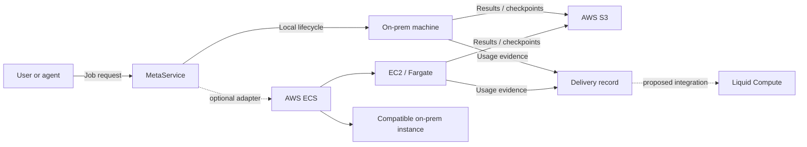

# Hybrid compute: on-prem, AWS, and Liquid Compute

Status: **a design for discussion, not a deployed integration**. The goal is to add cloud capacity and a compute market without losing the thing that makes MetaService useful: clear ownership of on-prem machines and workloads.

## Start with a real example

Imagine a user asks for a GPU job:

1. MetaService finds space on an on-prem machine.
2. A helper starts the job and records actual usage.
3. A result or checkpoint is written to object storage.
4. A signed usage/delivery record can later be shared with a market or customer.

AWS can help with cloud execution and storage. Liquid Compute can help with pricing, verification, settlement, and delivery. They do not need to control the same workload.

## The three roles

| System | Simple explanation | What it should own |
|---|---|---|
| **MetaService** | “Run and measure work on my machines” | On-prem machines, helpers, managed VMs, external-service inventory, sandboxes, lifecycle, usage, audit |
| **AWS** | “Run extra jobs and store results” | ECS tasks, EC2 instances, S3 objects, queues, IAM, logs |
| **Liquid Compute** | “Price, verify, trade, and settle compute” | Market/contract data, verification, clearing, settlement, physical delivery |

The most important sentence in this document:

> **Liquid Compute is not an ECS-like runtime.** Do not ask it to start a VM unless its official documentation explicitly says it does that.

## A safe end-to-end flow

Solid execution ownership stays with the controller that created the workload. Liquid Compute receives evidence only when its real API and delivery contract are known.

## AWS options, in plain language

### ECS Anywhere

Use it when you want one ECS control plane for compatible containers in AWS and on-prem.

It requires:

- A supported external machine
- Docker
- AWS Systems Manager Agent
- ECS agent
- Registration with an ECS cluster
- Stable internet access to AWS

It does **not** replace MetaService’s macOS helper or full VM lifecycle. GPU support also needs real verification of our OS, CPU architecture, drivers, and device access.

AWS’s current FAQ says existing tasks continue during a control-plane disconnect, but scaling/mutations stop and task credentials can expire. It also lists a price of **$0.01025 per managed external instance-hour**; verify that price again before budgeting.

### Direct EC2 adapter

Use this when MetaService needs to create and delete actual cloud VMs, not submit containers to ECS.

It needs:

- A mapping from MetaService sizes to EC2 instance types
- Images, disks, networking, and expiration policy
- Strict quotas and cost ceilings
- Actual termination verification so a failed delete does not keep billing

### Outposts

Outposts brings AWS-managed infrastructure to a site. It is not a lightweight way to reuse our current Macs and PCs. It is not the first experiment.

## Ownership is the main safety rule

| Workload | Controller |
|---|---|
| Apple Container VM | MetaService macOS helper |
| Incus VM/container | MetaService Linux helper |
| Existing Docker service | Its existing owner; MetaService discovers it as external |
| ECS Anywhere task | AWS ECS through a future adapter |
| EC2 instance | AWS provider adapter |
| Liquid Compute contract/delivery | Liquid Compute integration layer |

**Two controllers must not mutate one workload.**

If an ECS task appears as a Docker container, MetaService must recognize it as AWS-managed and suppress ordinary external start/stop/restart unless an explicit ownership handoff exists.

## Networking and data: start simple

Start with outbound TLS and object storage:

- **S3:** inputs, results, checkpoints, and delivery evidence
- **SQS:** queued jobs, if needed
- **IAM:** least-privilege task roles
- **CloudWatch:** logs and operational events
- **Existing MetaService connections:** helper commands and health

Do not start with a complex private network unless the workload needs it. AWS Site-to-Site VPN or Direct Connect becomes useful when you need private VPC access, predictable bandwidth, or substantial transfer requirements.

## What Liquid Compute can mean for us

Liquid Compute’s public site describes:

- Reference prices for selected data-center GPUs
- Exchange and clearing functions
- Physical delivery of compute
- Verification, maintenance, monitoring, and financing

That points to an **evidence and delivery adapter**, not a scheduler.

Possible things we could provide:

- Hardware model and verified capacity
- Availability windows and reliability history
- Benchmark/verification reports
- Metered delivery records and signed receipts
- Contract identifiers supplied by Liquid Compute

Things we do **not** know yet:

- API endpoints and authentication
- Whether consumer GPUs or Apple Silicon are accepted
- Required delivery/network exposure
- Verification and signing formats
- Pricing units, fees, rounding, and settlement timing
- Dispute, failure, and refund behavior

These are blockers until official documentation/access is provided. Do not invent answers.

## A phased plan that can stop safely

### Phase 0 — Ask and document

- Obtain Liquid Compute’s official participant/API documentation.
- Confirm supported hardware and the buyer/seller/verifier roles.
- Write down the real delivery and settlement contract.
- Keep credentials outside Git.

**Stop if:** there is no usable API or our hardware is unsupported.

### Phase 1 — Read-only AWS discovery

- Use an isolated non-production AWS project.
- Verify the chosen machine’s OS/CPU/GPU compatibility.
- Estimate ECS Anywhere and transfer costs.
- Produce a reversible registration runbook, but do not register yet.

**Stop if:** the agent, GPU, or cost model does not fit.

### Phase 2 — One reversible test job

- Use a non-sensitive container job with no office-network access.
- Use a dedicated S3 prefix and least-privilege IAM.
- Verify logs, quotas, disconnect behavior, cleanup, and actual cost.
- Leave existing production GPU services untouched.

**Stop if:** cleanup or cost limits cannot be proven.

### Phase 3 — Read-only Liquid Compute evidence export

- Export a signed verification/delivery bundle.
- Validate it against Liquid Compute’s real schema.
- Do not automate selling, bidding, settlement, or payout.

**Stop if:** the evidence cannot be validated or the required exposure is unacceptable.

## Non-goals for the first experiment

- No migration of existing services
- No replacement of MetaService with Kubernetes
- No automatic sale of idle capacity
- No random public Mac contributor network
- No credentials in Git
- No shared workload ownership
- No production GPU interruption

## Sources

- [Amazon ECS Anywhere FAQ](https://aws.amazon.com/ecs/anywhere/faqs/)
- [Registering an external ECS instance](https://docs.aws.amazon.com/AmazonECS/latest/developerguide/ecs-anywhere-registration.html)
- [External instances for Amazon ECS](https://docs.aws.amazon.com/AmazonECS/latest/developerguide/launch-type-external.md)
- [AWS hybrid HPC scenarios](https://docs.aws.amazon.com/wellarchitected/latest/high-performance-computing-lens/hybrid-scenarios.html)
- [Liquid Compute](https://liquidcompute.com/)

Product capabilities and prices change. Re-read the official pages before implementing.
